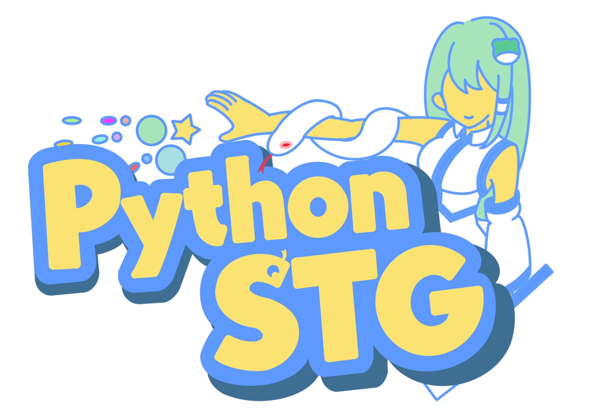
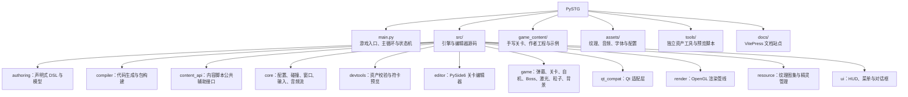

# PySTG

PySTG 是一个使用 Python 与 OpenGL 编写的东方风格弹幕射击（STG）游戏运行时及关卡创作工具集。底层使用 ModernGL 实例化渲染和 Numba 加速的弹幕池；内容层基于 `async`/`await` 协程编写关卡流程、波次和 Boss 符卡，与引擎实现解耦。

本仓库对应东方 Project 同人活动「九州拾遗」展出的游戏项目。

<p align="center">
  
</p>

<p align="center">
  <a href="https://www.python.org/downloads/"></a>
  <a href="LICENSE"></a>
  
</p>

## 核心特性

| 模块 | 说明 |
| --- | --- |
| 高性能弹幕运行时 | `OptimizedBulletPool` 采用 NumPy 结构化数组与 Numba JIT 批量更新，ModernGL 实例化绘制。 |
| 协程关卡脚本 | 用 `async`/`await` 顺序编写道中波次、敌人、Boss 与符卡，支持批量弹幕行为、分系统慢速与自定义规则。 |
| 完整 STG 玩法 | 判定点、擦弹、Power、符卡、Bomb、受击救援窗口、道具掉落、难度选择、练习模式与 Debug 跳转。 |
| 激光与视觉系统 | 直线激光、曲线激光、独立粒子池、主/附属角色动画、连续纹理拖尾、3D 背景场景与屏幕特效。 |
| 数据驱动资产 | 纹理图集、精灵动画、弹幕别名和敌人预设均由 JSON 管理。 |
| 代码驱动关卡编辑器 | 以受限声明式 Python 为唯一真源，提供线性程序流、Inspector、实时游戏预览与代码投影 Timeline。 |
| 独立资产工具箱 | 配套弹幕别名、纹理图集、自机、敌人别名、立绘与背景编辑器。 |
| 音频与回放 | 双层音频库（全局 + 关卡覆盖）、PCM 样本级循环 BGM；自动录制 Replay 并支持命令行回放。 |
| QQ 群弹幕互动 | 内置 UDP 监听服务，可对接 NoneBot 等机器人把群消息转化为弹幕。 |

## 环境要求

- Python 3.10 及以上（推荐 Python 3.12）
- 支持 OpenGL 3.3 及以上的显卡
- Windows 或 Linux（macOS 暂未测试）

## 安装

### 运行时依赖

```bash
git clone https://github.com/qwqpap/PythonSTG.git
cd PythonSTG
python -m pip install -r requirements.txt
```

> `requirements.txt` 锁定了兼容版本，其中 `numpy==1.26.4` 与 `numba==0.60.0` 需要成对升级，单独升级其中之一会导致 Numba 报版本不兼容。

### 开发与编辑器依赖

使用关卡编辑器、独立资产工具或开发脚本时，补充安装开发依赖并以可编辑模式安装项目：

```bash
python -m pip install -r requirements-dev.txt
python -m pip install -e .
```

安装完成后会提供两个 CLI 命令：`pystg`（等同 `python main.py`）和 `pystg-editor`（启动关卡编辑器）。

## 运行游戏

在仓库根目录执行 `python main.py`，常用参数如下：

| 命令 | 说明 |
| --- | --- |
| `python main.py` | 启动游戏并进入主菜单。 |
| `python main.py --stage=stage2` | 从指定关卡开始（`stage1` / `stage2` / `stage3`）。 |
| `python main.py --difficulty=normal` | 直接指定难度（`easy` / `normal` / `hard` / `lunatic`），跳过难度选择界面。 |
| `python main.py --content-entry=<模块>` | 加载自定义关卡入口模块，默认 `game_content.entry`。 |
| `python main.py --stage=asset_preview` | 进入资产预览关卡，浏览全部弹型与敌人。 |
| `python main.py --debug` | 启用调试模式，可在菜单跳转到任意波次、Boss 或符卡。 |
| `python main.py --profile` | 打印前 120 帧的逐帧耗时统计。 |
| `python main.py --hot-reload` | 监视弹幕别名、HUD 布局与激光配置，保存后自动重载。 |
| `python main.py --replay=<文件>` | 直接回放指定录像文件。 |
| `python main.py --project=<目录>` | 指定用于解析 `res://` 引用的项目根目录，默认为当前目录。 |

在波次或符卡类上设置 `DEBUG_BOOKMARK = True` 后，可在 `--debug` 模式下直接跳转调试。

## 启动关卡编辑器

```bash
pystg-editor game_content/authoring/code_editor_demo
```

- 作者工程位于 `game_content/authoring/<project_id>/`，以声明式 Python 作为唯一真源。试用时建议先复制 `code_editor_demo` 再编辑副本。
- 编辑器不反向解析 `game_content/stages/` 下的手写关卡。
- 点击 **运行**（或按 `F5`）时，编辑器会保存、构建并在真实游戏窗口中启动预览；预览期间继续编辑会提示源码已修改，需重新运行更新。
- 构建输出位于 `game_content/generated/<project_id>/`，属于可随时重建的临时产物，请勿手工修改或提交到 Git。

更多设计细节见 [编辑器设计概览](docs/EDITOR_PRODUCT_VISION.md) 与 [编辑器架构](docs/EDITOR_ARCHITECTURE.md)。

## 独立资产工具与符卡预览

启动可视化资产工具箱：

```bash
python tools/editor_launcher.py
```

也可以直接运行单个工具：

```bash
python tools/asset/asset_manager_qt.py        # 纹理资产编辑器
python tools/bullet/bullet_alias_manager.py   # 弹幕别名管理器
python tools/player/player_editor.py          # 自机编辑器
python tools/enemy/enemy_alias_manager.py     # 敌人别名管理器
python tools/portrait_editor/run.py           # 对话立绘渲染编辑器
python tools/stage/background_editor.py       # 数据驱动背景编辑器
```

需要单独调试某张手写符卡时，可直接运行实时预览器（支持保存自动重载与时间跳转）：

```bash
python tools/preview.py <脚本路径> --spell <符卡类名>
```

详细用法见 [独立资产工具指南](docs/EDITOR_TOOLS_GUIDE.md) 与 [开发与预览工具链](docs/DEVTOOLS_PHASE1.md)。

## 编写第一份弹幕脚本

```python
from src.game.stage.spellcard import SpellCard


class MySpell(SpellCard):
    name = "火符「示例」"
    hp = 1000
    time_limit = 45

    async def run(self):
        angle = 0
        while True:
            self.fire_circle(count=12, speed=2.0, start_angle=angle, color="red")
            angle += 10
            await self.wait(15)  # 等待 15 帧（约 0.25 秒）
```

`await self.wait(N)` 会让协程暂停 N 个仿真帧，这是 PySTG 弹幕脚本的基本写法。内容脚本通过 `StageScript`、`Wave`、`EnemyScript`、`SpellCard` 和 `self.ctx` 调用引擎能力，无需直接依赖渲染器或弹幕池内部实现。

完整 API 参考见 [弹幕脚本开发指南](docs/STAGE_SCRIPTING_GUIDE.md)，仓库内速查表见 [game_content/SCRIPTING.md](game_content/SCRIPTING.md)。

## 项目结构



| 路径 | 说明 |
| --- | --- |
| `main.py` | 游戏主入口。 |
| `src/` | 引擎运行时、作者核心、编译器与编辑器源码。 |
| `game_content/stages/` | 手写关卡内容，其中 `stage1` 为完整参考实现。 |
| `game_content/authoring/` | 声明式编辑器工程，内含示例工程 `code_editor_demo`。 |
| `game_content/examples/` | 高级运行时 API 示范脚本。 |
| `game_content/generated/` | 编辑器生成的构建输出（已加入 `.gitignore`）。 |
| `assets/` | 纹理、音频、字体、自机配置与 JSON 配置。 |
| `tools/` | 独立资产编辑器、符卡预览与资源校验工具。 |
| `docs/` | VitePress 文档源文件。 |

## 文档导航

完整文档位于 [`docs/`](docs/)，可按需求查阅：

### 内容与关卡开发

| 文档 | 内容 |
| --- | --- |
| [快速开始](docs/getting-started.md) | 环境搭建、运行游戏、试用编辑器与第一份脚本。 |
| [弹幕脚本开发指南](docs/STAGE_SCRIPTING_GUIDE.md) | 关卡、波次、敌人、Boss、批量弹幕、视觉演出与规则扩展完整参考。 |
| [敌人预设系统](docs/ENEMY_PRESET_SYSTEM.md) | 使用 JSON 预设快速配置杂兵外观与行为。 |
| [独立资产工具指南](docs/EDITOR_TOOLS_GUIDE.md) | 弹幕别名、纹理、自机、敌人、立绘与背景编辑器用法。 |
| [开发与预览工具链](docs/DEVTOOLS_PHASE1.md) | 资产校验、热重载与独立符卡预览器。 |

### 引擎与编辑器开发

| 文档 | 内容 |
| --- | --- |
| [引擎架构概览](docs/architecture.md) | 运行时分层、核心模块职责与帧内数据流。 |
| [纹理资产系统](docs/TEXTURE_ASSET_SYSTEM.md) | 图集配置、精灵定义与动画帧规范。 |
| [编辑器设计概览](docs/EDITOR_PRODUCT_VISION.md) | 代码驱动关卡编辑器的产品设计与核心原则。 |
| [编辑器架构](docs/EDITOR_ARCHITECTURE.md) | 作者模型、源码协议、构建事务、预览进程与 Timeline 设计。 |
| [编辑器开发进度](docs/EDITOR_IMPLEMENTATION_TODO.md) | 关卡编辑器各阶段完成状态与待办事项。 |

本地预览文档站点：

```bash
npm ci
npm run docs:dev
```

构建与预览静态站点可使用 `npm run docs:build` 和 `npm run docs:preview`。

## QQ 群弹幕互动

PySTG 内置 UDP 监听器（`src/game/emoji_danmaku/udp_receiver.py`），默认监听 `127.0.0.1:9999`。外部机器人（如 NoneBot 插件、Mirai 或自定义脚本）向该端口发送单行 UTF-8 JSON 数据包后，群成员发送的表情会变成弹幕落入战场。

### 消息格式

`cmd` 决定消息类型：`"emoji"` 表示直接发送表情，`"stg"` 表示转发 `/stg` 指令参数。

```json
{
  "cmd": "emoji",
  "emoji": "😂",
  "nickname": "群友A",
  "user_id": 10001
}
```

```json
{
  "cmd": "stg",
  "args": "😂",
  "nickname": "群友A",
  "user_id": 10001
}
```

| 字段 | 类型 | 必填 | 说明 |
| --- | --- | --- | --- |
| `cmd` | `str` | 是 | `"emoji"` 或 `"stg"`。 |
| `emoji` | `str` | `cmd == "emoji"` 时必填 | 单个表情字符。 |
| `args` | `str` | `cmd == "stg"` 时必填 | `/stg` 后的单个表情字符。 |
| `nickname` | `str` | 否 | 发送者昵称，默认空字符串。 |
| `user_id` | `int` | 否 | 发送者 QQ 号，默认 `0`。 |

### 支持的表情

默认识别 4 个表情，其余表情静默忽略：

| 表情 | 含义 |
| --- | --- |
| 😂 | 笑死 |
| 😡 | 怒 |
| 💩 | 大便 |
| 😅 | 苦笑 |

如需扩展，修改 `src/game/emoji_danmaku/udp_receiver.py` 顶部的 `EMOJI_SET`。

### 监听地址配置

默认 `127.0.0.1:9999` 仅接受本机数据包。跨机通信可在初始化 `EmojiDanmakuSystem` 时显式指定地址：

```python
EmojiDanmakuSystem(
    ctx=ctx,
    screen_size=screen_size,
    game_viewport=game_viewport,
    panel_origin=panel_origin,
    udp_host="0.0.0.0",
    udp_port=9999,
)
```

> 监听 `0.0.0.0` 会接收任意来源的 UDP 包。若直播机与机器人分属不同主机，建议通过 SSH 隧道或内网回环转发，避免直接暴露在公网。

### 发送端与 NoneBot 示例

```python
import json
import socket


def send_emoji(emoji: str, nickname: str = "anon", user_id: int = 0):
    payload = {
        "cmd": "emoji",
        "emoji": emoji,
        "nickname": nickname,
        "user_id": user_id,
    }
    sock = socket.socket(socket.AF_INET, socket.SOCK_DGRAM)
    sock.sendto(json.dumps(payload).encode("utf-8"), ("127.0.0.1", 9999))


send_emoji("😂", "测试群友", 10086)
```

```python
# nonebot_plugin/__init__.py（节选）
import json
import socket

from nonebot import on_command
from nonebot.adapters.onebot.v11 import MessageEvent

EMOJI_SET = {"😂", "😡", "💩", "😅"}
SOCK = socket.socket(socket.AF_INET, socket.SOCK_DGRAM)
TARGET = ("127.0.0.1", 9999)

stg_cmd = on_command("stg")


@stg_cmd.handle()
async def _(event: MessageEvent):
    args = str(event.get_message()).replace("/stg", "").strip()
    if args in EMOJI_SET:
        SOCK.sendto(
            json.dumps({
                "cmd": "stg",
                "args": args,
                "nickname": event.sender.nickname or "",
                "user_id": event.user_id,
            }).encode("utf-8"),
            TARGET,
        )
```

## 项目状态

- **已实现**：核心弹幕运行时、激光、粒子/动画/拖尾/背景/文字演出系统、四名自机配置（桃、燐、天子、咲夜）、Stage 1–3 手写关卡、代码驱动关卡编辑器（CD0–CD4 核心功能）、独立资产工具箱、Replay 回放与设置菜单。
- **持续完善中**：关卡编辑器创作体验打磨、难度选择菜单收尾、更多敌人行为与得分结算细节。
- **后续计划**：自定义按键绑定、画质选项、更多自机与符卡模板。

## 参与贡献

欢迎提交 Issue 或 Pull Request。改动代码时请遵循以下约定：

- 声明式作者工程放在 `game_content/authoring/<project_id>/`，手写关卡放在 `game_content/stages/stageN/`；不要提交 `game_content/generated/`。
- 内容脚本通过公开 Runtime API 调用引擎，避免在热路径中引入逐弹 Python 回调。
- 修改弹幕池或碰撞逻辑时保持 Numba 兼容，不在结构化数组中使用 Python 对象。

提交前建议运行以下检查：

```bash
python -m compileall -q main.py src game_content tools
python tools/validate_assets.py
git diff --check
```

若改动了文档，额外运行 `npm run docs:build` 确认链接与页面构建正常。

## 许可与资源版权

本项目代码采用 [MIT 许可证](LICENSE) 开源，版权归 qwqpap 所有。

`assets/` 中部分纹理和音频来自 Thlib 等社区资源库，版权归原作者所有，仅用于学习、研究和非商业二次创作，商用前请自行核实授权。其余立绘和音乐资源不可转载、不可商用。如涉及侵权，欢迎提交 Issue，维护者会及时替换。

## 相关链接

- [GitHub 仓库](https://github.com/qwqpap/PythonSTG)
- [在线文档](https://qwqpap.github.io/PythonSTG/)
