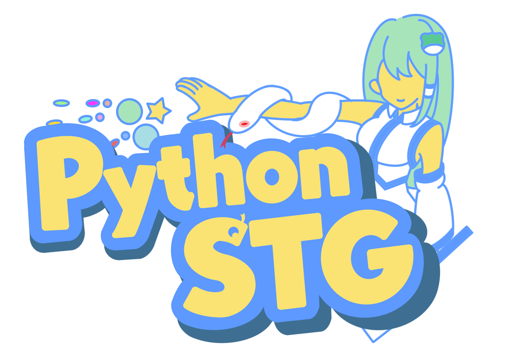

# PySTG

PySTG 是一个使用 Python 和 OpenGL 编写的弹幕射击（STG）游戏运行时与关卡创作工具集。运行时使用 ModernGL 实例化渲染和 Numba 加速的子弹池；内容层使用 `async`/`await` 协程描述关卡流程、波次和 Boss 符卡，与引擎内部实现解耦。

本存储库对应东方 Project 同人活动「九州拾遗」展出的游戏。

<p align="center">
  
</p>

<p align="center">
  <a href="https://www.python.org/downloads/"></a>
  <a href="LICENSE"></a>
  
</p>

## 功能

| 功能 | 说明 |
| --- | --- |
| 弹幕运行时 | `OptimizedBulletPool` 使用 NumPy 结构化数组和 Numba 编译的更新逻辑，渲染使用 ModernGL 实例化绘制。 |
| 协程关卡脚本 | 用 `async`/`await` 描述弹幕时序，不需要回调。 |
| STG 玩法 | 判定点、擦弹、Power、符卡、Bomb、道具掉落、练习模式和 Debug 跳转。 |
| 激光 | 直线激光（展开、持续、收缩三个阶段）和曲线激光。 |
| 数据驱动资产 | 纹理图集、精灵动画、弹幕别名和敌人预设都使用 JSON 配置。 |
| 独立资产工具 | 弹幕别名、纹理资产、自机、敌人、对话立绘和背景编辑器。 |
| 代码驱动关卡编辑器 | 以声明式 Python 为唯一真源，提供程序树、Inspector、真实游戏预览和代码投影 Timeline。 |
| 音频 | 全局音频库和关卡私有音频库；关卡音效可以覆盖同名的全局音效。 |
| 数据驱动背景 | 3D 透视投影、雾效和程序化生成。 |
| Replay | 自动录制输入并保存到 `userdata/replays/`，可以从主菜单或使用 `--replay` 回放。 |
| QQ 群弹幕互动 | 内置 UDP 监听器，通过 NoneBot 等外部机器人把群消息转换为攻击玩家的弹幕。 |

## 环境要求

- Python 3.10 或更高版本。当前验证的版本是 Python 3.12。
- 支持 OpenGL 3.3 或更高版本的显卡。
- Windows 或 Linux。macOS 未验证。

## 安装

### 安装运行时依赖项

```bash
git clone https://github.com/qwqpap/PythonSTG.git
cd PythonSTG
python -m pip install -r requirements.txt
```

`requirements.txt` 锁定一组互相兼容的版本，其中 `numpy==1.26.4` 和 `numba==0.60.0` 必须成对升级。只升级其中一个时，Numba 会报告 NumPy 版本不受支持。

### 安装开发依赖项

关卡编辑器、独立资产工具和开发脚本需要额外的依赖项：

```bash
python -m pip install -r requirements-dev.txt
python -m pip install -e .
```

安装后可以使用两个命令：`pystg` 等同于 `python main.py`，`pystg-editor` 用于打开关卡编辑器。

## 运行游戏

在存储库根目录运行 `python main.py`。下表列出常用选项。

| 命令 | 用途 |
| --- | --- |
| `python main.py` | 从 Stage 1 开始游戏。 |
| `python main.py --stage=stage2` | 从指定关卡开始，可取 `stage1`、`stage2`、`stage3`。 |
| `python main.py --stage=asset_preview` | 进入资产预览模式，浏览所有弹型和敌人。 |
| `python main.py --debug` | 启用调试模式，在菜单中跳转到任意波次、Boss 或符卡。 |
| `python main.py --profile` | 输出前 120 帧的逐帧耗时统计。 |
| `python main.py --hot-reload` | 监视弹幕别名、HUD 布局和激光配置，文件变化后自动重新加载。 |
| `python main.py --replay=<文件>` | 直接回放指定的录像文件。 |
| `python main.py --project=<目录>` | 指定项目根目录，用于解析 `res://` 资源引用。默认使用当前目录。 |

主菜单提供开始游戏、测试关卡、查看重放、设置和退出选项。设置菜单可以调整音效音量、BGM 音量和全屏模式，并选择默认自机。

标记 `DEBUG_BOOKMARK = True` 的波次和符卡会出现在 `--debug` 的跳转菜单中，可以跳过重复的道中流程。

## 打开关卡编辑器

1. 安装开发依赖项，见[安装](#安装)。
2. 在存储库根目录运行以下命令：

```bash
pystg-editor game_content/authoring/code_editor_demo
```

`game_content/authoring/<project_id>/` 下的声明式 Python 是唯一作者真源。编辑器不会解析 `game_content/stages/` 下的手写关卡。试用时，先复制 `code_editor_demo` 目录，再把命令参数换成副本路径。

编辑器的行为：

- 打开工程后，从开始 Stage 查看引用的波次、敌人和 Boss。在程序流中选择节点，然后在 Inspector 中修改参数。
- 只有在 **运行** 菜单中选择 **运行当前单元**（F5）、**运行整个工程** 或 **运行当前关卡** 时，编辑器才会保存、构建并启动真实游戏预览。
- 预览运行期间修改源码后，状态栏显示“源码已改，需重新运行”。再次运行才会更新预览。
- 生成的文件位于 `game_content/generated/<project_id>/`。这些文件是构建输出，可以删除，不要手工修改或提交。

编辑器各阶段的实施状态和剩余验收见[代码驱动关卡编辑器实施 TODO](docs/EDITOR_IMPLEMENTATION_TODO.md)。

## 运行独立资产工具

```bash
python tools/editor_launcher.py
```

启动器以卡片形式列出弹幕别名、纹理资产、自机、敌人、对话立绘和背景编辑器。也可以直接运行单个工具：

```bash
python tools/asset/asset_manager_qt.py        # 纹理资产编辑器
python tools/bullet/bullet_alias_manager.py   # 弹幕别名管理器
python tools/player/player_editor.py          # 自机编辑器
```

工具用途、操作方式和常见问题见[编辑器工具指南](docs/EDITOR_TOOLS_GUIDE.md)。

要单独检查一个手写符卡，可以在真实渲染器中预览它：

```bash
python tools/preview_spell.py <脚本路径> [符卡类名]
```

详细用法见[开发工具链](docs/DEVTOOLS_PHASE1.md)。

## 编写第一份弹幕脚本

```python
from src.game.stage.spellcard import SpellCard

class MySpell(SpellCard):
    name = "火符「示例」"
    hp = 1000
    time_limit = 45

    async def run(self):
        angle = 0
        while True:
            self.fire_circle(count=12, speed=2.0, start_angle=angle, color="red")
            angle += 10
            await self.wait(15)  # 等待 15 帧，约 0.25 秒
```

`await self.wait(N)` 让协程暂停 N 帧，引擎每帧推进一步。这是 PySTG 弹幕脚本的核心模式。

手写脚本使用 `StageScript`、`Wave`、`EnemyScript` 和 `SpellCard` 等基类，通过 `self.ctx` 调用引擎，不直接导入引擎内部模块：

```python
from src.game.stage.spellcard import SpellCard, NonSpell
from src.game.stage.wave_base import Wave
from src.game.stage.enemy_script import EnemyScript
from src.game.stage.stage_base import StageScript, BossDef
from src.game.stage.boss_base import nonspell, spellcard
```

完整 API 见[弹幕脚本开发指南](docs/STAGE_SCRIPTING_GUIDE.md)，仓库内的内容约定见 [`game_content/SCRIPTING.md`](game_content/SCRIPTING.md)。

## 项目结构

```mermaid
flowchart TB
    root["PySTG"]
    main["main.py<br/>游戏入口、主循环与状态机"]
    src["src/<br/>引擎与编辑器代码"]
    content["game_content/<br/>手写关卡、作者工程与生成产物"]
    assets["assets/<br/>纹理、音频、字体与配置"]
    tools["tools/<br/>独立资产工具与校验脚本"]
    docs["docs/<br/>VitePress 文档站点"]

    root --> main
    root --> src
    root --> content
    root --> assets
    root --> tools
    root --> docs

    src --> authoring["authoring：声明式作者 API"]
    src --> compiler["compiler：内容编译器"]
    src --> content_api["content_api：内容脚本的稳定导入接口"]
    src --> core["core：配置、碰撞、窗口、输入"]
    src --> devtools["devtools：资产校验与符卡预览"]
    src --> editor["editor：关卡编辑器界面"]
    src --> game["game：子弹、关卡、玩家、Boss、激光、道具、音频"]
    src --> qt_compat["qt_compat：Qt 绑定桥接"]
    src --> render["render：OpenGL 渲染管线"]
    src --> resource["resource：纹理图集与精灵管理"]
    src --> ui["ui：HUD、菜单与对话框"]

    content --> stages["stages/：手写关卡"]
    content --> authoring_dir["authoring/：声明式作者工程"]
    content --> generated["generated/：生成产物，不提交"]
```



| 路径 | 说明 |
| --- | --- |
| `main.py` | 游戏入口。 |
| `src/` | 引擎、作者核心和编辑器代码。 |
| `game_content/stages/` | 手写关卡内容。Stage 1 是最完整的参考实现。 |
| `game_content/authoring/` | 声明式作者工程。`code_editor_demo` 是示例工程。 |
| `assets/` | 纹理、音频、字体、自机配置和 JSON 配置。 |
| `tools/` | 独立资产工具、符卡预览和资产校验脚本。 |
| `docs/` | VitePress 文档站点源文件。 |

## 文档

完整文档位于 [`docs/`](docs/)，任务导航见[文档导航](docs/index.md)。

### 编写关卡内容

| 文档 | 内容 |
| --- | --- |
| [快速开始](docs/getting-started.md) | 环境搭建、运行游戏、第一份脚本和目录约定。 |
| [弹幕脚本开发指南](docs/STAGE_SCRIPTING_GUIDE.md) | 波次、符卡、敌人和 Boss 的完整 API 参考。 |
| [敌人预设系统](docs/ENEMY_PRESET_SYSTEM.md) | 用 JSON 预设创建杂兵。 |
| [编辑器工具指南](docs/EDITOR_TOOLS_GUIDE.md) | 独立资产工具的用法。 |

### 开发引擎和编辑器

| 文档 | 内容 |
| --- | --- |
| [架构概览](docs/architecture.md) | 引擎分层、模块依赖和数据流。 |
| [纹理资产系统](docs/TEXTURE_ASSET_SYSTEM.md) | 图集加载、精灵定义和动画配置。 |
| [开发工具链](docs/DEVTOOLS_PHASE1.md) | 资产校验、符卡预览和热重载。 |
| [编辑器产品愿景](docs/EDITOR_PRODUCT_VISION.md) | 声明式 Python、程序树、真实预览和 Timeline 的产品契约。 |
| [编辑器架构边界](docs/EDITOR_ARCHITECTURE.md) | 作者核心、编译器、Qt、预览和 Timeline 之间的依赖约束。 |
| [编辑器实施 TODO](docs/EDITOR_IMPLEMENTATION_TODO.md) | CD0-CD4 阶段的实施顺序、状态和验收 Gate。 |

在本地启动文档站点：

```bash
npm ci
npm run docs:dev
```

站点构建使用 `npm run docs:build`，预览构建结果使用 `npm run docs:preview`。

## QQ 群弹幕互动

PySTG 内置一个 UDP 监听器（`src/game/emoji_danmaku/udp_receiver.py`），默认监听 `127.0.0.1:9999`。外部程序（NoneBot 插件、Mirai HTTP API 或自写脚本）向该端口发送一行 UTF-8 编码的 JSON 数据包后，群成员发送的表情会变成下落并攻击玩家的弹幕。

### 消息格式

`cmd` 字段决定消息类型：`"emoji"` 表示直接发送表情，`"stg"` 表示转发 `/stg` 指令的参数。

直接发送表情：

```json
{
  "cmd": "emoji",
  "emoji": "😂",
  "nickname": "群友A",
  "user_id": 10001
}
```

转发 `/stg` 指令：

```json
{
  "cmd": "stg",
  "args": "😂",
  "nickname": "群友A",
  "user_id": 10001
}
```

### 字段

| 字段 | 类型 | 必填 | 说明 |
| --- | --- | --- | --- |
| `cmd` | 字符串 | 是 | 取值为 `"emoji"` 或 `"stg"`。 |
| `emoji` | 字符串 | `cmd` 为 `"emoji"` 时必填 | 单个表情字符。 |
| `args` | 字符串 | `cmd` 为 `"stg"` 时必填 | `/stg` 指令的参数，即单个表情字符。 |
| `nickname` | 字符串 | 否 | 发送者昵称。默认值为空字符串。 |
| `user_id` | 整数 | 否 | 发送者 QQ 号。默认值为 0。 |

### 支持的表情

引擎只识别下表中的 4 个表情。其他表情会被丢弃，并且不输出日志。

| 表情 | 含义 |
| --- | --- |
| 😂 | 笑死 |
| 😡 | 怒 |
| 💩 | 大便 |
| 😅 | 苦笑 |

要增加表情，编辑 `src/game/emoji_danmaku/udp_receiver.py` 顶部的 `EMOJI_SET`。

### 监听地址

默认地址 `127.0.0.1:9999` 只接受本机数据包。要让其他计算机上的机器人发送数据，在创建 `EmojiDanmakuSystem` 时传入 `udp_host` 和 `udp_port`：

```python
EmojiDanmakuSystem(
    ctx=ctx, screen_size=screen_size,
    game_viewport=game_viewport, panel_origin=panel_origin,
    udp_host="0.0.0.0",   # 监听所有网卡
    udp_port=9999,
)
```

> **注意**
>
> `0.0.0.0` 会接受任意来源的 UDP 数据包，在公网环境中可能被滥用。如果直播主机和机器人不在同一台计算机上，使用 SSH 隧道或专用的内网回环地址。

### 最小发送端示例

```python
import json
import socket

def send_emoji(emoji: str, nickname="anon", user_id=0):
    payload = {
        "cmd": "emoji",
        "emoji": emoji,
        "nickname": nickname,
        "user_id": user_id,
    }
    sock = socket.socket(socket.AF_INET, socket.SOCK_DGRAM)
    sock.sendto(json.dumps(payload).encode("utf-8"), ("127.0.0.1", 9999))

send_emoji("😂", "测试群友", 10086)
```

### NoneBot 适配示例

```python
# nonebot_plugin/__init__.py（节选）
import json
import socket

from nonebot import on_command
from nonebot.adapters.onebot.v11 import MessageEvent

EMOJI_SET = {"😂", "😡", "💩", "😅"}
SOCK = socket.socket(socket.AF_INET, socket.SOCK_DGRAM)
TARGET = ("127.0.0.1", 9999)

stg_cmd = on_command("stg")

@stg_cmd.handle()
async def _(event: MessageEvent):
    args = str(event.get_message()).replace("/stg", "").strip()
    if args in EMOJI_SET:
        SOCK.sendto(json.dumps({
            "cmd": "stg",
            "args": args,
            "nickname": event.sender.nickname or "",
            "user_id": event.user_id,
        }).encode("utf-8"), TARGET)
```

## 项目状态

### 已实现

- 核心引擎：子弹池、激光、碰撞、道具、音频和渲染管线。
- 玩家系统：桃、燐、天子三名自机，包含移动、射击、Option、动画状态机和判定点。
- 关卡系统：`StageScript`、`Wave`、`SpellCard`、Boss、对话、练习模式和 Staff Roll。
- 三关内容：Stage 1 至 Stage 3，包含道中波次、Boss 符卡和对白。
- 数据驱动背景：3D 透视、雾效和程序化生成。
- 独立资产工具：弹幕别名、纹理资产、自机、敌人、背景、对话立绘和 UI 布局。
- Replay：自动录制、主菜单回放和 `--replay` 命令行回放。
- 设置菜单：音效音量、BGM 音量、全屏模式和默认自机。

### 进行中

- 关卡编辑器的创作体验和真人易用性验收。技术阶段状态和剩余验收见[编辑器实施 TODO](docs/EDITOR_IMPLEMENTATION_TODO.md)。
- 更多敌人行为模式。
- 得分与结算系统的完善。

### 计划

- 按键绑定和画质选项。
- 更多可选自机和 Boss 符卡模板。

## 参与贡献

提交拉取请求或问题之前，先阅读 [`AGENTS.md`](AGENTS.md) 中的仓库约定，再按[文档导航](docs/index.md)查阅与本次改动相关的章节。

内容约定：

- 声明式作者工程放在 `game_content/authoring/<project_id>/`，手写关卡放在 `game_content/stages/stageN/`。
- `game_content/generated/` 是生成目录，不要提交。
- 内容脚本通过公开运行时 API 使用引擎。
- 修改引擎时保持 Numba 兼容：子弹池中不能使用 Python 对象。

提交前运行与 CI 相同的检查：

```bash
python -m compileall -q main.py src game_content tools
python tools/validate_assets.py
git diff --check
```

仓库当前不包含可运行的 pytest 测试套件（`tests/` 为空），因此以上检查是主要的自动化验证手段。

编辑器改动还需要真实环境验证：无界面路径使用真实运行时，界面交互在 Windows 的 PySide6 窗口和 GLFW 子窗口中复现实际输入。汇总验证结果时，分别说明 Structural、Runtime、Native、Performance 和 Usability 证据，未观察的类别写 `not run`。

只修改文档时，检查链接并构建文档站点：

```bash
npm ci
npm run docs:build
```

文档构建通过不代表游戏可以运行，也不代表编辑器易于使用。

## 许可与资源版权

代码以 [MIT 许可证](LICENSE) 开源，版权归 qwqpap 所有。

`assets/` 中的部分纹理和音频来自 Thlib 等社区资源库，版权归原作者所有。商用前自行确认资源来源和授权。本存储库仅用于学习、研究和非商业再创作。其余立绘和音乐资源不可转载、不可商用。

如果发现侵权资源，可以提交问题（Issue），维护者会替换相关资源。

## 相关链接

- [GitHub 存储库](https://github.com/qwqpap/PythonSTG)
- [在线文档](https://qwqpap.github.io/PythonSTG/)

## 关于 AI 辅助

本存储库在开发过程中使用了 AI 辅助。欢迎通过拉取请求改进实现中不够完善的部分。
