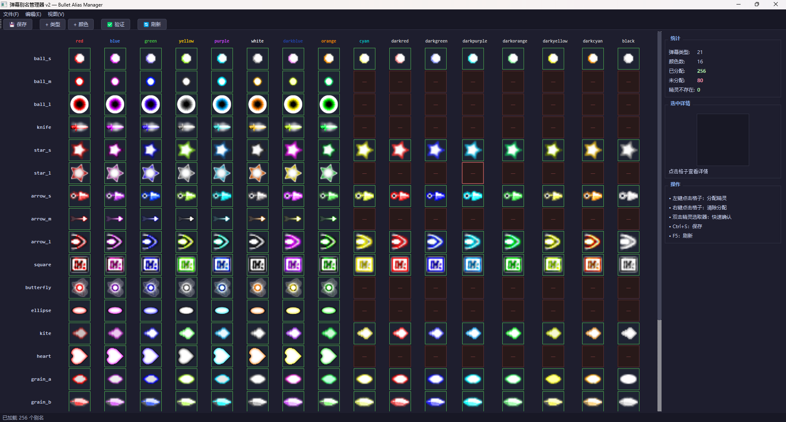
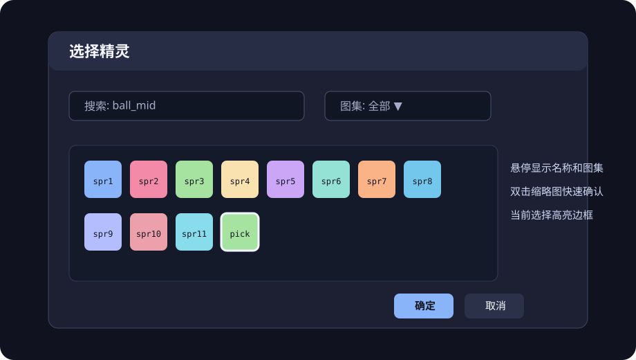

# 独立资产工具指南

本文介绍 PySTG 配套的独立可视化资产编辑器。代码驱动关卡编辑器见 [快速开始](getting-started.md) 和 [编辑器设计概览](EDITOR_PRODUCT_VISION.md)。

---

## 1. 工具一览

所有独立资产工具通过 `src.qt_compat` 使用 PySide6，统一采用 Catppuccin Mocha 暗色主题，公共代码位于 `tools/editor_common.py`。

| 工具 | 脚本路径 | 用途 |
| --- | --- | --- |
| 工具箱启动器 | `tools/editor_launcher.py` | 集中启动下方 6 个资产工具 |
| 弹幕别名管理器 | `tools/bullet/bullet_alias_manager.py` | 维护弹型 + 颜色到精灵名的映射（`assets/bullet_aliases.json`） |
| 纹理资产编辑器 | `tools/asset/asset_manager_qt.py` | 编辑精灵图集裁切区域、动画帧、激光三段与自机贴图 |
| 自机编辑器 | `tools/player/player_editor.py` | 编辑自机动画状态机、射击类型与子机配置 |
| 敌人别名管理器 | `tools/enemy/enemy_alias_manager.py` | 管理敌人贴图与别名映射 |
| 立绘渲染编辑器 | `tools/portrait_editor/run.py` | 调整对话立绘槽位、说话者位移与非说话者透明度/饱和度 |
| 背景编辑器 | `tools/stage/background_editor.py` | 浏览背景资源并编辑数据驱动背景配置 |

### 安装依赖

在仓库根目录安装开发依赖：

```bash
python -m pip install -r requirements-dev.txt
python -m pip install -e .
```

---

## 2. 工具箱启动器

```bash
python tools/editor_launcher.py
```

启动器以 2×3 卡片网格展示全部 6 个资产工具，点击卡片会在独立子进程中打开对应编辑器。

> 注意：关闭启动器窗口时，会一并终止由该启动器拉起的子进程。如果需要独立常驻，可以直接运行单个工具的 Python 脚本。

---

## 3. 弹幕别名管理器

```bash
python tools/bullet/bullet_alias_manager.py
```

关卡脚本中使用抽象名称发弹（如 `bullet_type="ball_m", color="red"`），引擎通过 `assets/bullet_aliases.json` 将其映射到具体的图集精灵名（如 `ball_mid1`）。本工具用于可视化维护这张映射表。



### 格子状态

| 颜色 | 状态 | 说明 |
| --- | --- | --- |
| 🟢 绿色 | 已分配且精灵存在 | 正常 |
| 🟡 黄色 | 已分配但图集中找不到 | 需要重新指定或检查图集配置 |
| 🔴 红色 | 未分配 | 尚未配置映射 |

### 常用操作

- **分配精灵**：左键单击格子打开精灵选取器，支持按名称和所属图集过滤，双击缩略图确认。
- **清除分配**：右键单击格子选择“清除此格子”。
- **增删类型 / 颜色**：通过工具栏按钮或“编辑”菜单维护行列。
- **验证与保存**：点击工具栏“验证”检查全部映射是否有效，`Ctrl+S` 保存到 `assets/bullet_aliases.json`。



### 输出格式

```json
{
  "version": "1.0",
  "mapping": {
    "ball_m": {
      "red": "ball_mid1",
      "blue": "ball_mid2",
      "green": "ball_mid3"
    }
  }
}
```

不同弹型在精灵图集中的编号顺序并不统一，使用别名表可以让脚本与底层图集编号解耦。

---

## 4. 纹理资产编辑器

```bash
python tools/asset/asset_manager_qt.py
```

纹理资产编辑器直接调用引擎的 `UnifiedTextureManager`（`src/resource/unified_texture.py`），读写格式与游戏运行时一致，支持 `assets/images/{bullet,laser,player,enemy,item,background,ui}/` 和 `assets/players/*/` 下的配置。

主要功能：

- 在纹理图集上直接框选精灵 `rect` 区域、按 `N × M` 网格批量切图
- 拖拽设置旋转/渲染中心点与圆形碰撞半径
- 编辑序列帧动画并实时播放预览
- 预览三段式激光（head / body / tail）与 16 色变体组
- 原子写回对应的图集 JSON 文件

详细快捷键与已知限制见 `tools/asset/ASSET_MANAGER_QT_README.md`。

---

## 5. 自机编辑器

```bash
python tools/player/player_editor.py
```

用于可视化编辑 `assets/players/<角色名>/config.json`（当前仓库包含 `tao`、`orin`、`tenshi`、`sakuya`）：

- 空闲 / 左移 / 右移等动画状态机及帧序列预览
- 主武器、副武器发射参数配置
- 子机（Option）位置偏移、动画与攻击配置
- 高速 / 低速移动速度与判定半径

---

## 6. 其他独立工具

- **敌人别名管理器**（`tools/enemy/enemy_alias_manager.py`）：维护敌人贴图与别名映射。
- **立绘渲染编辑器**（`tools/portrait_editor/run.py`）：实时预览并调整对话立绘的屏幕位置、焦点高亮与退场样式，写回 `assets/ui/dialog_portrait_layout.json`。
- **背景编辑器**（`tools/stage/background_editor.py`）：编辑数据驱动背景配置。

---

## 7. 共享模块（`tools/editor_common.py`）

编写新的 Qt 资产工具时，可直接复用 `tools/editor_common.py` 提供的公共能力：

- **路径常量**：`PROJECT_ROOT`、`ASSET_ROOT`、`BULLET_IMAGE_DIR`、`BULLET_ALIASES_PATH`、`PLAYERS_ROOT`。
- **统一主题**：`apply_dark_theme(widget)` 或 `DARK_THEME`。
- **精灵加载与缓存**：`load_all_bullet_sprites()`、`get_all_sprite_names()`、`get_sprite_entry_map()`、`PixmapCache`。
- **别名读写**：`load_bullet_aliases()`、`save_bullet_aliases()`、`generate_default_aliases()`。

新增工具后，在 `tools/editor_launcher.py` 中添加对应的 `ToolCard` 即可接入统一启动器。

---

## 8. 常见问题

- **启动时报错缺少 `PySide6` 或找不到 `src`**：确认使用同一个 Python 环境，在仓库根目录执行 `python -m pip install -r requirements-dev.txt` 和 `python -m pip install -e .`。
- **弹幕别名管理器网格为空**：确认从仓库根目录启动，并检查 `assets/images/bullet/` 下是否存在图集 JSON 与 PNG。
- **保存修改后游戏未生效**：重启游戏即可加载新配置；调试弹幕别名、HUD 布局或激光配置时，也可以带 `--hot-reload` 启动游戏自动重载。
