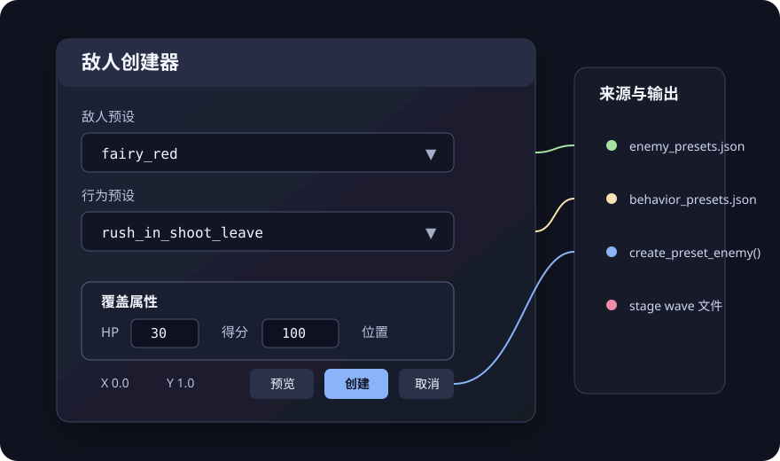
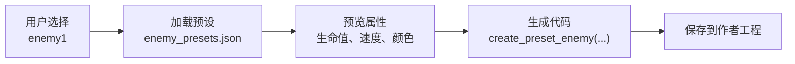

# 敌人预设系统

敌人预设系统让内容脚本复用敌人属性：预设保存外观和数值，脚本只描述行为。预设文件是运行时资产，不是声明式关卡编辑器的作者格式；编辑器仍以 `game_content/authoring/<project_id>/` 下的 Python 为唯一真源。

## 概念

预设配置位于 `assets/configs/enemy_presets.json`，包含四节：

| 节 | 数量 | 作用 | 运行时是否自动应用 |
| --- | --- | --- | --- |
| `presets` | 14 | 敌人的精灵、生命值、得分、碰撞半径和弹幕默认值 | 是，加载 `PresetEnemy` 时应用 |
| `behavior_presets` | 5 | 可复用的行动流程（进场、射击、撤退） | 是，设置 `behavior_preset` 后自动执行 |
| `attack_presets` | 4 | 弹幕发射参数（圆形、自机狙、螺旋、随机散射） | 否，由脚本读取 `self._attack_data` 后自行发射 |
| `movement_presets` | 3 | 路径移动参数（直线、正弦波、螺旋） | 否，保留配置，当前运行时未使用 |

## 使用方式

### 预设外观 + 行为预设

行为预设覆盖常见杂兵流程，子类只需要两行：

```python
from src.game.stage.preset_enemy import PresetEnemy


class AutoRedFairy(PresetEnemy):
    preset_id = "enemy1"
    behavior_preset = "rush_in_shoot_leave"
    # 不要覆盖 run()，基类会执行预设行为
```

### 预设外观 + 自定义行为

需要独特行为时自行编写 `run()`，数值仍来自预设：

```python
class CustomRedFairy(PresetEnemy):
    preset_id = "enemy1"

    async def run(self):
        await self.move_to(self.x, 0.3, duration=60)

        for _ in range(3):
            self.fire_circle(
                count=8,
                speed=self._default_bullet_speed(),
                bullet_type=self.defaults["bullet_type"],
                color=self.defaults["bullet_color"],
            )
            await self.wait(self.defaults.get("fire_rate", 20))

        await self.move_to(self.x, -0.2, duration=60)
```

### 预设外观 + 攻击预设

攻击预设不自动发射。脚本读取 `self._attack_data` 后决定何时发射：

```python
class MixedOrb(PresetEnemy):
    preset_id = "enemy_orb"
    attack_preset = "spiral_dense"

    async def run(self):
        attack = self._attack_data or {}
        params = attack.get("params", {})
        # 按 attack["type"] 和 params 发射，示例见
        # game_content/stages/stage1/enemies/preset_examples.py
```

### 运行时动态创建

`create_preset_enemy` 返回一个敌人类，适合编辑器或关卡生成器：

```python
from src.game.stage.preset_enemy import create_preset_enemy

EnemyClass = create_preset_enemy(
    preset_id="enemy_orb",
    behavior="side_pass_shoot",
    overrides={"hp": 50, "score": 200},   # 可选，覆盖预设值
)
enemy = EnemyClass()
```

### 在波次中生成

```python
class MyWave(Wave):
    async def run(self):
        self.spawn_enemy_class(AutoRedFairy, x=0.0, y=1.0)
        await self.wait(60)
```

## 属性优先级

实例属性按以下顺序取值，越靠前优先级越高：

1. 类属性或 `create_preset_enemy(overrides=...)` 中的 `hp`、`sprite`、`score`、`hitbox_radius`。
2. `presets` 节中的同名值。

```python
class StrongRedFairy(PresetEnemy):
    preset_id = "enemy1"   # 预设 hp 为 30
    hp = 80                # 实际使用 80
```

子弹速度取 `defaults["bullet_speed"]`；该字段不存在时回退到 `defaults["move_speed"]`，可以使用 `self._default_bullet_speed()` 读取。

## 敌人预设列表

| 预设 ID | 名称 | 生命值 | 得分 | 默认弹型 / 颜色 |
| --- | --- | --- | --- | --- |
| `enemy1` | 红色妖精 | 30 | 100 | `ball_s` / 红 |
| `enemy2` | 蓝色妖精 | 30 | 100 | `ball_s` / 蓝 |
| `enemy3` | 绿色妖精 | 35 | 150 | `ball_m` / 绿 |
| `enemy4` | 黄色妖精 | 35 | 150 | `ball_m` / 黄 |
| `enemy5` | 红色大妖精 | 60 | 250 | `scale_s` / 红 |
| `enemy6` | 蓝色大妖精 | 60 | 250 | `scale_s` / 蓝 |
| `enemy7` | 红色中型敌 | 80 | 300 | `ball_l` / 红 |
| `enemy8` | 蓝色中型敌 | 80 | 300 | `ball_l` / 蓝 |
| `enemy9` | 大型敌 | 150 | 500 | `ball_l` / 紫 |
| `enemy10` | 粉色妖精 | 30 | 100 | `ball_s` / 粉 |
| `enemy11` | 紫色妖精 | 30 | 100 | `ball_s` / 紫 |
| `enemy12` | 青色妖精 | 35 | 150 | `ball_m` / 青 |
| `kedama` | 毛玉 | 20 | 50 | `rice_s` / 粉 |
| `enemy_orb` | 幽灵球 | 50 | 200 | `scale_m` / 紫 |

每个预设的 `defaults` 还包含 `move_speed` 和 `fire_rate`。精灵映射见 `game_content/stages/stage1/enemies/README.md`。

### 行为预设列表

| 预设 ID | 名称 | 流程 |
| --- | --- | --- |
| `rush_in_shoot_leave` | 冲入-射击-离开 | 移动到 `y=0.3`，连射 3 轮，移动到 `y=-0.2` 离场。 |
| `side_pass_shoot` | 横向掠过射击 | 移动到屏幕另一侧，途中持续射击。 |
| `circle_strafe` | 环绕射击 | 以 `[0, 0.3]` 为圆心、半径 0.3 绕行一圈，然后持续射击。 |
| `dive_attack` | 俯冲攻击 | 等待 30 帧，连射 5 轮，快速俯冲到 `y=-0.5`。 |
| `ambush_retreat` | 突袭-撤退 | 移动到 `y=0.4`，发射两轮圆形弹幕，再移动到 `y=1.2` 撤退。 |

### 攻击预设列表

| 预设 ID | 名称 | `type` | 参数 |
| --- | --- | --- | --- |
| `burst_8way` | 8 方向连发 | `circle` | `count`、`speed`、`bursts`、`burst_interval` |
| `aimed_3shot` | 自机狙 3 连发 | `aimed` | `count`、`speed`、`interval`、`spread` |
| `spiral_dense` | 密集螺旋 | `spiral` | `arms`、`bullets_per_arm`、`rotation_speed` |
| `random_spray` | 随机散射 | `random` | `count`、`speed_min`、`speed_max`、`angle_variance` |

## 行为预设支持的动作

`PresetEnemy` 在 `_execute_behavior_preset()` 中处理以下 `action`：

| 动作 | 参数 | 说明 |
| --- | --- | --- |
| `move_to` | `target`、`duration`、`speed` | 移动到目标。`target` 支持 `"y=0.3"`、`"x=0.5"`、`"x=-x"`（镜像到另一侧）和 `[x, y]`。提供 `duration` 时忽略 `speed`；只提供 `speed` 时按归一化坐标/秒换算帧数。 |
| `move_linear` | `dx`、`dy`、`duration`，或 `direction`、`speed` | 匀速直线移动。也可以用 `direction`（度，0 = 右）和 `speed` 指定方向和速度。 |
| `move_circle` | `center`、`radius`、`duration`、`start_angle`、`clockwise` | 绕圆心移动一圈。 |
| `shoot_burst` | `count`、`interval` | 发射 `count` 轮圆形弹幕。 |
| `shoot_continuous` | `count`、`interval` | 发射 `count` 发自机狙。 |
| `shoot_pattern` | `pattern`、`count` | `pattern` 取 `circle` 或 `arc`。 |
| `wait` | `duration` | 等待指定帧数。 |

未列出的动作会被忽略。要在项目内扩展动作，请同时修改 `_execute_behavior_preset()` 和本节表格。

## 工具脚本

```bash
python tools/enemy/list_presets.py                                    # 列出所有预设
python tools/enemy/list_presets.py --detail enemy1                    # 查看预设详情
python tools/enemy/list_presets.py --export editor_presets.json       # 导出为编辑器 JSON
python tools/enemy/list_presets.py --usage enemy1 --behavior rush_in_shoot_leave
```

`--export` 不带文件名时输出到标准输出。`--usage` 生成可直接粘贴的示例代码。

## 编辑器集成





## 最佳实践

- 为常见敌人类型建立预设，避免在多个脚本中重复数值。
- 用行为预设组合流程，而不是增加继承层级。
- 预设 ID 使用 `snake_case`，类名使用 `PascalCase`。
- 不要为细微差别新建预设；在子类中覆盖单个属性即可。
- 行为预设之间不要相互引用。

## 扩展预设

新增敌人预设：

1. 在 `assets/configs/enemy_presets.json` 的 `presets` 节添加条目。
2. 确认 `sprite` 使用的精灵已存在。
3. 运行 `python tools/enemy/list_presets.py` 验证。

新增行为预设：在 `behavior_presets` 节添加条目。如果用到新动作，先在 `PresetEnemy._execute_behavior_preset()` 中实现。

## 故障排除

### 提示“未找到预设”

```
ValueError: 未找到预设: fairy_red
```

`fairy_red`、`orb_blue`、`ghost_fire_red` 等 ID 来自早期文档，并不存在于当前配置。请使用[敌人预设列表](#敌人预设列表)中的 ID，或运行 `python tools/enemy/list_presets.py` 查看。

### 行为预设没有执行

子类覆盖了 `run()`，基类就不会执行行为预设：

```python
class MyEnemy(PresetEnemy):
    preset_id = "enemy1"
    behavior_preset = "rush_in_shoot_leave"

    async def run(self):   # 覆盖后预设行为不会执行
        pass
```

需要预设行为时删除 `run()`；需要自定义行为时删除 `behavior_preset`。

## 示例代码

- `game_content/stages/stage1/enemies/preset_examples.py`：四种用法和多个示例敌人类。
- `game_content/stages/stage1/waves/enemy_showcase_wave.py`：按顺序展示各预设的波次。
