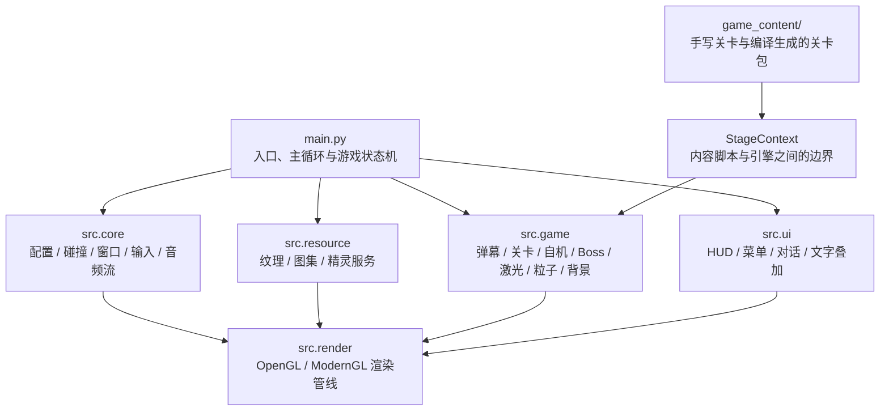
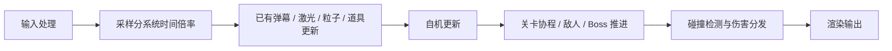
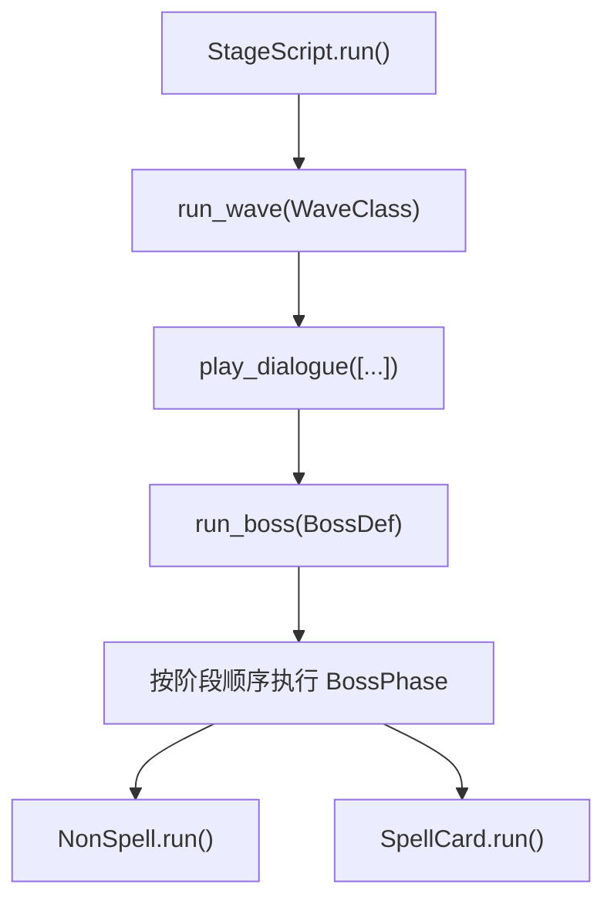
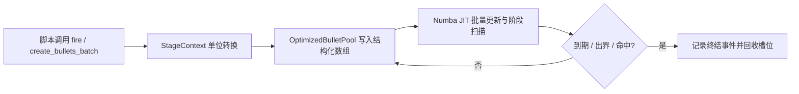
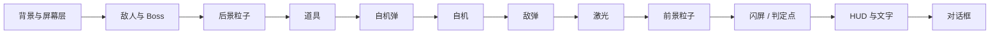
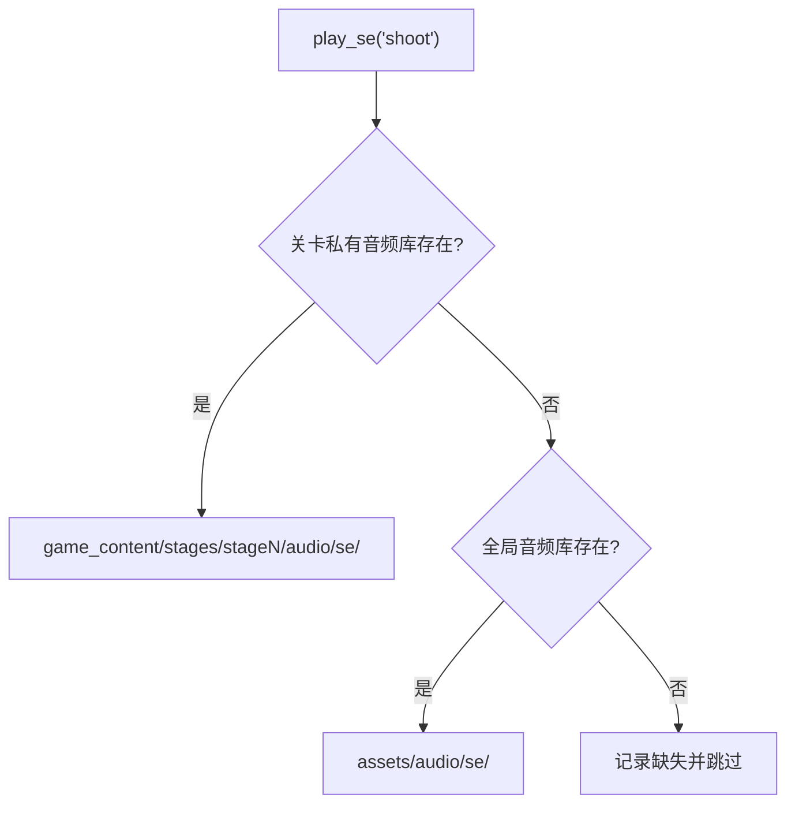

# 引擎架构概览

本文介绍 PySTG 引擎运行时的分层结构、核心模块职责以及单帧数据流。声明式作者工程经 `src.authoring` 解析、`src.compiler` 生成后，也运行在这套引擎之上；关卡编辑器自身架构见 [编辑器架构](EDITOR_ARCHITECTURE.md)。

## 分层结构

内容脚本通过 `StageContext` 和高层基类调用引擎能力，不直接耦合渲染器或底层数组实现。

## 模块说明

### `src/core` — 基础设施

| 模块 | 职责 |
| --- | --- |
| `config.py` | 全局配置常量（逻辑分辨率 `384×448`、窗口视口、缓冲上限） |
| `window.py` / `input_manager.py` | GLFW 窗口、固定帧率时钟与键盘输入 |
| `collision.py` / `collision_shapes.py` | Numba 加速碰撞检测（圆、旋转矩形 SAT、激光与曲线段几何、擦弹） |
| `audio_backend.py` / `bgm_stream.py` | miniaudio 混音后端与流式 PCM 音乐解码（支持样本级循环点与淡入淡出） |
| `sprite_registry.py` | 全局精灵 UV 注册表 |
| `project_context.py` | `res://` 项目相对路径解析 |
| `preview_protocol.py` | 编辑器与预览子进程的 NDJSON 通信协议 |

### `src/resource` — 资源管理

| 模块 | 职责 |
| --- | --- |
| `texture_asset.py` | 纹理图集加载、精灵与帧动画定义、UV 计算 |
| `unified_texture.py` | 跨图集统一纹理管理 |
| `service.py` / `asset_manager.py` | 资源服务与缓存 |
| `sprite/` | 精灵兼容层 |

### `src/game` — 游戏逻辑

| 模块 | 职责 |
| --- | --- |
| `bullet/` | `OptimizedBulletPool`（SoA 结构化数组 + Numba）、多阶段行为（`behavior.py`）、批量快照（`batch.py`）、穿屏后处理（`motion.py`）与终结转换队列（`termination.py`） |
| `stage/` | 关卡核心：`StageScript`、`Wave`、`EnemyScript`、`SpellCard`、`BossBase`、`StageContext`、`StageManager`、移动曲线（`motion.py`）、预设敌人、对话与练习模式 |
| `tasks.py` | 固定 60 Hz 帧任务调度与取消/清理作用域 |
| `state.py` | 跨关 `RunState` 与分系统暂停/慢速控制（`TimeControl`） |
| `player/` | 自机移动、射击、子机、持续激光/爆炸攻击池（`player_bullet.py`）与受击救援契约（`hit.py`） |
| `damage.py` | 统一伤害事实（`DamageHit`）与同帧目标伤害分发 |
| `laser.py` | 直线激光与曲线激光池化管理 |
| `item.py` | SoA 道具池、吸附逻辑与稀疏收集规则入口 |
| `particle.py` / `animation.py` / `trail.py` | 独立非碰撞粒子池、角色主/附属动画控制、连续纹理拖尾 |
| `background.py` / `background_render/` | 无 GL 的 3D 背景状态（静态面片、相机、雾、屏幕层）与 OpenGL 背景渲染器 |
| `overlay.py` / `screen_effects.py` | 游戏区/HUD 文字叠加、闪屏脉冲与屏幕震动 |
| `audio.py` | 双层音频库（全局音频 + 关卡私有覆盖） |
| `userdata/` | 设置、进度与 Replay 录制/回放 |

### `src/render` — 渲染管线

| 模块 | 职责 |
| --- | --- |
| `renderer.py` | 主渲染器，协调各子渲染器、视口裁剪与加载期资源预热 |
| `optimized_bullet_renderer.py` | 敌弹与自机弹批量实例化绘制 |
| `particle_renderer.py` | 粒子、角色受控动画与连续拖尾复用实例/网格绘制 |
| `laser_renderer.py` | 直线与曲线激光几何构建及绘制 |
| `player_renderer.py` / `item_renderer.py` | 自机、判定点与道具绘制 |

### `src/ui` — 界面

| 模块 | 职责 |
| --- | --- |
| `hud.py` / `ui_renderer.py` | HUD 侧栏、LRU 文字缓存与游戏区文字叠加绘制 |
| `bitmap_font.py` | 位图字体渲染 |
| `dialog_gl_renderer.py` | 对话框与立绘渲染 |
| `main_menu_renderer.py` / `pause_menu_renderer.py` / `continue_menu_renderer.py` / `loading_renderer.py` / `staff_roll_renderer.py` | 各游戏界面渲染 |

### `src/authoring`、`src/compiler`、`src/editor` — 关卡编辑器链路

| 包 | 职责 |
| --- | --- |
| `src/authoring/` | 声明式 DSL、AST/tokenize 源码读写、模板展开、Headless 模型与 Timeline 投影 |
| `src/compiler/` | 确定性代码生成、Source Map、事务构建与内容入口加载 |
| `src/editor/` | PySide6 桌面关卡编辑器界面、单一 `EditorSession`、预览进程宿主 |

## 单帧数据流

### 控制更新顺序（60 Hz）

当前帧中由脚本新发射的子弹或转换生成的新敌人，均从下一仿真步开始运动与碰撞，避免行为受底层槽位编号顺序影响。

### 关卡内部执行流

### 子弹生命周期

### 渲染层级（从后到前）

### 音频查找顺序

关卡私有音效和 BGM 可直接覆盖全局同名音频。
