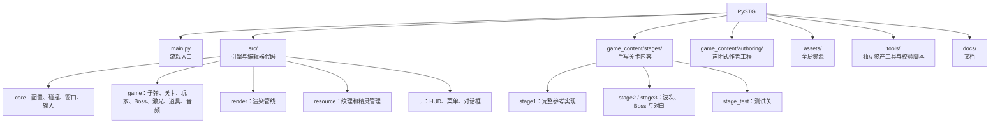

# 快速开始

本文介绍如何安装 PySTG、运行游戏、打开关卡编辑器，以及编写第一份弹幕脚本。

## 环境要求

- Python 3.10 或更高版本。当前验证的版本是 Python 3.12。
- 支持 OpenGL 3.3 或更高版本的显卡。
- Windows 或 Linux。macOS 未验证。

## 安装

### 安装运行时依赖项

```bash
git clone https://github.com/qwqpap/PythonSTG.git
cd PythonSTG
python -m pip install -r requirements.txt
```

`requirements.txt` 锁定一组互相兼容的版本，其中 `numpy==1.26.4` 和 `numba==0.60.0` 必须成对升级。只升级其中一个时，Numba 会报告 `Numba needs NumPy x.x or less`。

### 安装开发依赖项

关卡编辑器、独立资产工具和开发脚本需要额外的依赖项：

```bash
python -m pip install -r requirements-dev.txt
python -m pip install -e .
```

关卡编辑器以声明式 Python 为唯一真源，不打开旧 Scene/Pattern JSON。阶段进度和剩余验收见[代码驱动编辑器实施 TODO](EDITOR_IMPLEMENTATION_TODO.md)。纹理、自机、敌人、背景、对话和 UI 等独立工具见[编辑器工具指南](EDITOR_TOOLS_GUIDE.md)。

## 运行游戏

在存储库根目录运行 `python main.py`。

```bash
python main.py                         # 默认 Stage 1
python main.py --stage=stage2          # 从指定关卡开始，可取 stage1、stage2、stage3
python main.py --stage=asset_preview   # 资产预览：浏览所有弹型和敌人
python main.py --debug                 # 调试模式：菜单可跳转到任意波次、Boss 或符卡
python main.py --profile               # 输出前 120 帧的逐帧耗时
python main.py --help                  # 列出全部选项
```

`--debug` 是开发期最常用的开关：标记 `DEBUG_BOOKMARK = True` 的波次和符卡会出现在跳转菜单中，不需要每次从头打到 Boss。

## 打开关卡编辑器

安装开发依赖项后，在存储库根目录运行：

```bash
pystg-editor game_content/authoring/code_editor_demo
```

`code_editor_demo` 是可编辑的作者工程。试用时先复制到 `game_content/authoring/` 下的新目录，再把命令参数换成副本路径。编辑器不会反向解析 `game_content/stages/` 下的手写关卡。

打开工程后，从开始 Stage 查看引用的波次、敌人和 Boss。在程序流中选择节点，然后在 Inspector 中修改参数。只有在 **运行** 菜单中选择 **运行当前单元**（F5）、**运行整个工程** 或 **运行当前关卡** 时，编辑器才会保存、构建并启动真实游戏预览。预览运行期间修改源码后，状态栏显示“源码已改，需重新运行”。保存后重开、Undo/Redo 和完整创作流程的验收要求见 TODO；启动成功本身不代表这些验收通过。

生成文件位于 `game_content/generated/<project_id>/`，可以重新构建，不要手工修改或提交。

## 项目结构



## 引擎与内容的边界

PySTG 把引擎和内容分开：

- `src/` 是引擎，提供子弹池、渲染、碰撞、激光和音频等底层能力。
- `game_content/` 是内容，只描述发生什么：弹幕怎么飞、敌人怎么动、Boss 出什么招。

手写运行时脚本使用以下基类；声明式编辑器工程使用 `src.authoring.dsl`，两者目录和语法不同：

```python
from src.game.stage.spellcard import SpellCard, NonSpell   # 符卡 / 非符
from src.game.stage.wave_base import Wave                   # 道中波次
from src.game.stage.enemy_script import EnemyScript         # 敌人脚本
from src.game.stage.stage_base import StageScript, BossDef  # 整面流程
from src.game.stage.boss_base import nonspell, spellcard    # Boss 阶段组合
```

这些类通过 `self.fire()`、`self.wait(N)` 和 `self.ctx` 调用引擎，不直接导入引擎内部模块。

## 编写第一份手写脚本

```python
class MySpell(SpellCard):
    name = "火符「示例」"
    hp = 1000
    time_limit = 45

    async def run(self):
        angle = 0
        while True:
            self.fire_circle(count=12, speed=2.0, start_angle=angle, color="red")
            angle += 10
            await self.wait(15)   # 暂停 15 帧（约 0.25 秒）
```

`await self.wait(N)` 让协程暂停 N 帧，引擎每帧推进一步。这是 PySTG 弹幕脚本的核心模式。

完整 API 见[弹幕脚本开发指南](STAGE_SCRIPTING_GUIDE.md)。

## 一个手写关卡的结构

| 路径 | 作用 |
| --- | --- |
| `game_content/stages/stage1/__init__.py` | 关卡包入口 |
| `game_content/stages/stage1/stage_script.py` | 整面流程，必需 |
| `game_content/stages/stage1/waves/` | 道中波次，例如 `opening_wave.py`、`fairy_wave.py` |
| `game_content/stages/stage1/spellcards/` | Boss 符卡，例如 `nonspell_1.py`、`spell_2.py` |
| `game_content/stages/stage1/enemies/` | 可复用敌人定义 |
| `game_content/stages/stage1/dialogue/` | 对话脚本 |
| `game_content/stages/stage1/audio/` | 关卡私有音频，可覆盖全局同名音效 |
| `game_content/stages/stage1/images/` | 关卡私有图片资源 |

`stage_script.py` 控制整个关卡的流程：

```python
class Stage1(StageScript):
    id = "stage1"
    name = "Stage 1"
    bgm = "00.wav"
    boss_bgm = "01.wav"

    async def run(self):
        await self.run_wave(OpeningWave)           # 道中波次
        await self.run_wave(FairyWave)

        await self.play_dialogue([                  # Boss 前对话
            ("Hinanawi_Tenshi", "left", "准备好了吗？"),
            ("Reiuji_Utsuho", "right", "来吧！"),
        ])

        await self.run_boss(self.boss)              # Boss 战
```

对话立绘渲染参数位于 `assets/ui/dialog_portrait_layout.json`，可以使用编辑器调整：

```bash
python tools/dialog/dialog_portrait_editor.py
```

## 下一步

- 编写弹幕：见[弹幕脚本开发指南](STAGE_SCRIPTING_GUIDE.md)。
- 快速创建杂兵：见[敌人预设系统](ENEMY_PRESET_SYSTEM.md)。
- 管理资产：见[编辑器工具](EDITOR_TOOLS_GUIDE.md)。
- 了解引擎内部：见[架构概览](architecture.md)。

写内容时先参考 `game_content/stages/stage1/` 下的现有脚本，这是当前最完整的实现样例。
