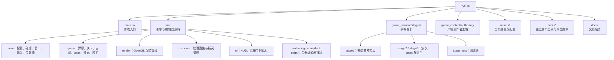

# 快速开始

本指南介绍如何安装 PySTG、运行游戏、启动关卡编辑器，以及编写第一份弹幕脚本。

## 环境要求

- Python 3.10 及以上（推荐 Python 3.12）
- 支持 OpenGL 3.3 及以上的显卡
- Windows 或 Linux（macOS 暂未测试）

## 安装

### 1. 安装运行时依赖

```bash
git clone https://github.com/qwqpap/PythonSTG.git
cd PythonSTG
python -m pip install -r requirements.txt
```

`requirements.txt` 锁定了经过验证的依赖组合，其中 `numpy==1.26.4` 与 `numba==0.60.0` 必须成对升级，否则 Numba 会报 NumPy 版本不兼容错误。

### 2. 安装开发与编辑器依赖

如需使用关卡编辑器、独立资产工具或开发脚本，继续安装开发依赖：

```bash
python -m pip install -r requirements-dev.txt
python -m pip install -e .
```

安装后即可直接使用 `pystg` 和 `pystg-editor` 两个命令。

## 运行游戏

在仓库根目录运行 `python main.py`：

```bash
python main.py                         # 启动游戏并进入主菜单
python main.py --stage=stage2          # 从指定关卡开始（stage1 / stage2 / stage3）
python main.py --difficulty=normal     # 指定难度（easy / normal / hard / lunatic）
python main.py --stage=asset_preview   # 资产预览模式：浏览全部弹型和敌人
python main.py --debug                 # 调试模式：菜单可跳转到任意波次、Boss 或符卡
python main.py --profile               # 输出前 120 帧的逐帧耗时统计
python main.py --help                  # 查看全部命令行选项
```

调试阶段最常用的是 `--debug`：只要给波次或符卡类加上 `DEBUG_BOOKMARK = True`，它就会出现在跳转菜单中，无需每次从道中开头重打。

## 启动关卡编辑器

安装开发依赖后，在仓库根目录运行：

```bash
pystg-editor game_content/authoring/code_editor_demo
```

基本工作方式：

- `game_content/authoring/<project_id>/` 下的声明式 Python 是唯一作者真源。建议先复制 `code_editor_demo` 再修改副本。
- 编辑器不反向解析 `game_content/stages/` 下的手写关卡。
- 打开工程后，可以在程序流中选择或插入节点，并在右侧 Inspector 中修改参数。
- 点击 **运行** 菜单中的 **运行当前单元**（`F5`）、**运行当前关卡** 或 **运行整个工程** 时，编辑器会自动保存、构建并拉起真实游戏窗口进行预览。
- 预览运行期间继续修改源码不会自动热重载，状态栏会提示“源码已改，需重新运行”，再次运行即可刷新画面。
- 构建输出放在 `game_content/generated/<project_id>/`，属于可随时重建的临时目录，不要手工修改或提交到 Git。

关于编辑器的产品设计与工程边界，详见 [编辑器设计概览](EDITOR_PRODUCT_VISION.md) 与 [编辑器架构](EDITOR_ARCHITECTURE.md)。

## 项目目录概览



## 引擎与内容的职责划分

PySTG 将引擎底层与关卡内容分开维护：

- `src/` 提供弹幕池、碰撞、渲染、激光、音频、粒子与关卡调度等通用能力。
- `game_content/` 只描述玩法内容：敌人怎么出场、弹幕怎么飞、Boss 如何切换阶段。

手写脚本通过以下几个公开基类和 `self.ctx` 调用引擎，不直接导入底层模块：

```python
from src.game.stage.spellcard import SpellCard, NonSpell   # 符卡 / 非符
from src.game.stage.wave_base import Wave                   # 道中波次
from src.game.stage.enemy_script import EnemyScript         # 敌人脚本
from src.game.stage.stage_base import StageScript, BossDef  # 整面流程与 Boss 定义
from src.game.stage.boss_base import nonspell, spellcard    # Boss 阶段组装
```

> 声明式编辑器工程使用 `src.authoring.dsl`，与手写脚本语法不同，但构建后会生成标准运行时类，共用同一套引擎。

## 编写第一份手写符卡

```python
from src.game.stage.spellcard import SpellCard


class MySpell(SpellCard):
    name = "火符「示例」"
    hp = 1000
    time_limit = 45

    async def run(self):
        angle = 0
        while True:
            self.fire_circle(count=12, speed=2.0, start_angle=angle, color="red")
            angle += 10
            await self.wait(15)  # 等待 15 帧（约 0.25 秒）
```

`await self.wait(N)` 会让协程暂停 N 个仿真帧，引擎按 60 Hz 推进一步。配合 `tools/preview.py` 可以实时预览单张符卡而无需启动整关：

```bash
python tools/preview.py game_content/stages/stage1/spellcards/spell_2.py
```

## 一个手写关卡的目录结构

| 路径 | 作用 |
| --- | --- |
| `game_content/stages/stage1/__init__.py` | 关卡包入口 |
| `game_content/stages/stage1/stage_script.py` | 整面流程（必需） |
| `game_content/stages/stage1/waves/` | 道中波次脚本 |
| `game_content/stages/stage1/spellcards/` | Boss 非符与符卡脚本 |
| `game_content/stages/stage1/enemies/` | 可复用敌人定义 |
| `game_content/stages/stage1/dialogue/` | 对话脚本 |
| `game_content/stages/stage1/audio/` | 关卡私有音频（可覆盖全局同名音效） |
| `game_content/stages/stage1/images/` | 关卡私有贴图 |

`stage_script.py` 串联整关节奏：

```python
class Stage1(StageScript):
    id = "stage1"
    name = "Stage 1"
    bgm = "00.wav"
    boss_bgm = "01.wav"

    async def run(self):
        await self.run_wave(OpeningWave)
        await self.run_wave(FairyWave)

        await self.play_dialogue([
            ("Hinanawi_Tenshi", "left", "准备好了吗？"),
            ("Reiuji_Utsuho", "right", "来吧！"),
        ])

        await self.run_boss(self.boss)
```

需要调整对话立绘位置和样式时，可以运行立绘编辑器修改 `assets/ui/dialog_portrait_layout.json`：

```bash
python tools/portrait_editor/run.py
```

## 下一步

- 学习完整脚本 API：[弹幕脚本开发指南](STAGE_SCRIPTING_GUIDE.md)
- 快速配置杂兵：[敌人预设系统](ENEMY_PRESET_SYSTEM.md)
- 使用可视化资产工具：[独立资产工具指南](EDITOR_TOOLS_GUIDE.md)
- 了解引擎内部结构：[引擎架构概览](architecture.md)

初次编写手写关卡时，推荐先翻阅 `game_content/stages/stage1/` 中的完整参考代码。
